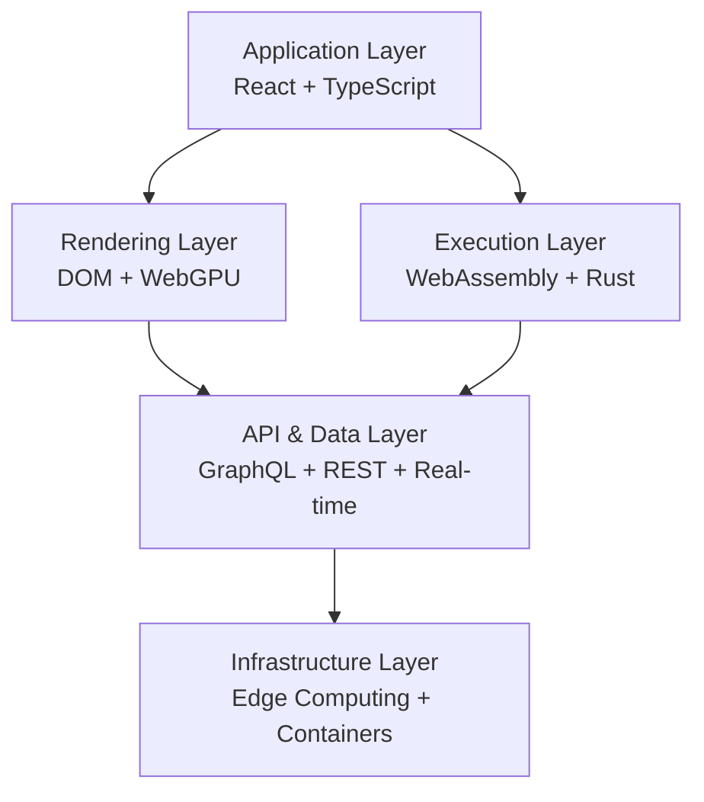

# React Infinite

### The next-generation full-stack architecture for high-performance React applications.

**Build faster. Render smarter. Scale further.**

React Infinite is an experimental full-stack architecture exploring the intersection of React, WebAssembly, WebGPU, AI-assisted optimization, and edge computing.

Its vision is to make modern applications faster, more intelligent, resource-efficient, and adaptable across devices and environments.

> Transforming how we build, render, optimize, and scale the next generation of applications.

---

## Project Status

**Status:** Experimental / Architecture in Development

React Infinite is currently a proposed platform architecture. Its features, APIs, performance characteristics, and deployment capabilities are under development and validation.

Performance figures and demonstration APIs in the original concept are illustrative, not independently benchmarked or production guarantees.

---

## Vision

Traditional web architectures can encounter performance bottlenecks as applications become increasingly complex and data-intensive.

React Infinite explores a different approach:

- React and TypeScript for application development.
- WebGPU for specialized high-performance graphical workloads.
- WebAssembly for computation-intensive execution.
- AI-assisted optimization for intelligent resource management.
- Edge computing for geographically distributed workloads.
- Modern APIs and real-time communication for connected applications.

The goal is not simply to create another React framework, but to investigate a unified architecture for high-performance application development.

---

## Core Features

### 1. WebGPU Rendering

Explore GPU-accelerated rendering for computationally intensive interfaces, graphics, and visualization.

Potential applications:
- Interactive 3D environments.
- Real-time data visualization.
- Large-scale simulations.
- GPU-accelerated image processing.

### 2. AI-Driven Optimization

An experimental optimization layer designed to improve application responsiveness and resource utilization.

Potential capabilities:
- Intelligent resource preloading.
- Adaptive caching.
- Workload analysis.
- Predictive resource allocation.
- Performance recommendations.

### 3. WebAssembly Execution

Use WebAssembly to execute performance-critical workloads with near-native computational efficiency.

Potential applications:
- Data processing.
- Numerical computation.
- Image processing.
- Cryptographic operations.
- Complex simulations.

### 4. Edge Computing

Explore distributed application execution closer to end users.

Key objectives:
- Lower network latency.
- Distributed workload execution.
- Efficient content delivery.
- Geographically distributed services.
- Resilient application infrastructure.

### 5. Custom Compilation

Investigate compilation pipelines for optimized application modules.

Technologies under consideration:
- TypeScript.
- Rust.
- AssemblyScript.
- LLVM.
- WebAssembly toolchains.
- Vite plugins.

### 6. Cross-Platform Development

Explore reusable application architecture across:

- Web.
- iOS.
- Android.
- Extended Reality (XR).
- Embedded and IoT environments.

Cross-platform support will be validated independently for each target.

### 7. Real-Time Data Infrastructure

Support real-time application experiences through:

- WebSockets.
- Server-Sent Events.
- Publish/Subscribe systems.
- Event-driven architecture.
- Distributed synchronization.

### 8. Modern API Infrastructure

Explore type-safe and efficient communication through:

- GraphQL.
- REST.
- gRPC.
- Real-time APIs.
- Distributed caching.

### 9. Security by Design

Security is a foundational architectural requirement.

Areas of focus:
- Encryption in transit and at rest.
- Authentication and authorization.
- Secure execution boundaries.
- Secrets management.
- Dependency security.
- Application observability.

---

## Architecture

React Infinite is organized around five architectural layers.



### Frontend

The frontend provides the application and user interaction layer.

Proposed technologies:
- React.
- TypeScript.
- Vite.
- Modern browser APIs.
- WebGPU where appropriate.

### Backend

The backend provides application services, computation, and distributed execution.

Technologies under consideration:
- Rust.
- WebAssembly.
- Edge runtimes.
- GraphQL.
- gRPC.
- Event-driven services.

### WebAssembly Pipeline

The compilation layer investigates transforming selected computation-intensive modules into WebAssembly.

Potential toolchain:
- Rust and wasm-bindgen.
- AssemblyScript.
- LLVM.
- Emscripten.
- Custom Vite integration.

WebAssembly is intended to complement JavaScript and React, not replace the entire application runtime.

### API and Data Flow

The communication layer connects application interfaces, backend services, and distributed infrastructure.

Potential capabilities:
- Typed API contracts.
- Real-time communication.
- Efficient serialization.
- Caching.
- Data synchronization.

---

## Technology Stack

| Layer | Technologies |
|---|---|
| Frontend | React, TypeScript, Vite |
| Graphics | WebGPU, Canvas |
| Execution | WebAssembly, Rust |
| Compilation | LLVM, AssemblyScript |
| Backend | Rust, Edge Runtime |
| APIs | GraphQL, REST, gRPC |
| Real-time | WebSockets, Pub/Sub |
| Infrastructure | Docker, Kubernetes |
| Optimization | AI-assisted performance analysis |
| Development | Git, CI/CD, automated testing |

Technology choices will be evaluated through working prototypes and performance measurements.

---

## Performance Philosophy

React Infinite prioritizes measurable performance improvements rather than theoretical performance claims.

The project aims to investigate:

| Metric | Objective |
|---|---|
| Initial Load | Reduce startup overhead |
| JavaScript Execution | Minimize unnecessary computation |
| Rendering | Improve rendering efficiency |
| Interaction Latency | Increase responsiveness |
| Memory Usage | Optimize resource consumption |
| Network Latency | Improve distributed delivery |
| Scalability | Support increasing workloads |

### Benchmarking

Performance comparisons should use reproducible workloads and consistent environments.

Planned benchmarking areas:

- React DOM versus specialized GPU rendering.
- JavaScript versus WebAssembly computation.
- Client-side versus edge execution.
- Caching strategies.
- Resource utilization under concurrent workloads.

No performance superiority is claimed until supported by published benchmark results.

---

## Getting Started

React Infinite's public CLI and installation workflow are planned but are not yet available.

### Intended Developer Experience

The following illustrates the proposed API direction and is not currently executable:

```ts
const app = createApp({
  name: "MyNextGenApp",

  renderer: "webgpu",
  execution: "wasm",

  optimization: {
    enabled: true,
    strategy: "adaptive",
  },

  backend: {
    runtime: "edge",
  },
});
```

### Planned CLI Experience

The proposed developer workflow:

```bash
# Install the future CLI
npm install -g @react-infinite/cli

# Create a project
infinite create my-app

# Enter the project
cd my-app

# Start development
infinite dev
```

These commands will become available when the CLI is implemented and published.

---

## Development Roadmap

### Phase 1 — Architectural Foundation
- [ ] Define the core architecture.
- [ ] Establish the React and TypeScript foundation.
- [ ] Design the module system.
- [ ] Establish performance benchmarks.
- [ ] Define API contracts.

### Phase 2 — Execution Engine
- [ ] Introduce WebAssembly modules.
- [ ] Prototype Rust integration.
- [ ] Investigate compilation pipelines.
- [ ] Implement module execution management.

### Phase 3 — Rendering Infrastructure
- [ ] Develop the rendering abstraction.
- [ ] Prototype WebGPU integration.
- [ ] Evaluate rendering performance.
- [ ] Develop visualization examples.

### Phase 4 — Distributed Infrastructure
- [ ] Implement backend services.
- [ ] Prototype edge execution.
- [ ] Introduce real-time communication.
- [ ] Establish caching infrastructure.

### Phase 5 — Intelligence and Optimization
- [ ] Develop performance profiling.
- [ ] Implement optimization recommendations.
- [ ] Prototype adaptive resource management.
- [ ] Evaluate AI-assisted optimization.

### Phase 6 — Developer Ecosystem
- [ ] Develop the CLI.
- [ ] Publish documentation.
- [ ] Build interactive examples.
- [ ] Establish a benchmarking suite.
- [ ] Release an experimental developer preview.

---

## Guiding Principles

1. **Performance First:** Every optimization should be measurable.
2. **Developer Experience:** Advanced technology should simplify development, not complicate it.
3. **Open Architecture:** Modular components and clearly defined interfaces.
4. **Interoperability:** Work with the existing JavaScript and Web ecosystem.
5. **Security by Design:** Security should be foundational.
6. **Evidence-Based Engineering:** Architectural decisions should be supported by experiments and benchmarks.

---

## Contributing

Contributions, architecture discussions, research, and experimental implementations are welcome.

Potential contribution areas:

- React application architecture.
- WebAssembly.
- Rust.
- WebGPU.
- Compiler infrastructure.
- Edge computing.
- AI-assisted optimization.
- Performance engineering.
- Developer tooling.

Contribution guidelines will be published as the project matures.

---

## Community and Resources

- **GitHub:** Repository discussions and source code.
- **Documentation:** Technical documentation and architecture decisions.
- **Examples:** Experimental applications and demonstrations.
- **Playground:** Future interactive environment for testing components.

---

## License

License to be determined.

---

**React Infinite**

*Building the next generation of high-performance application infrastructure.*
